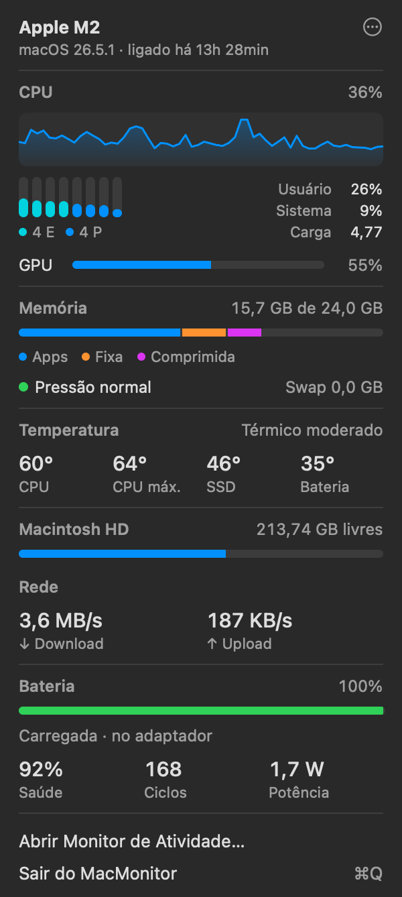
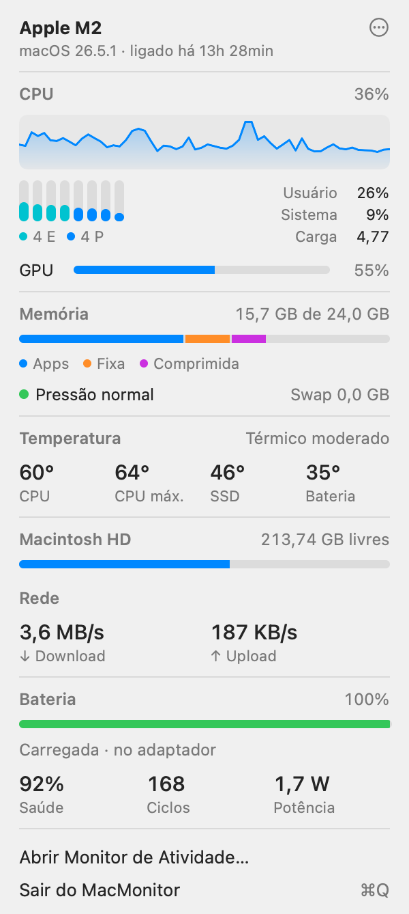

# MacMonitor

A small, native macOS menu bar app that shows what your Mac is doing: CPU, GPU, memory, temperatures, disk, network and battery. It's built with SwiftUI, has no dependencies, and is designed to feel like the panels the system already uses, such as Battery and Control Center.

<p align="center">
  
</p>

<p align="center">
  
  &nbsp;&nbsp;
  
</p>

> The interface text is in Brazilian Portuguese.

## Features

**Menu bar**
- Shows live CPU usage, memory usage and CPU temperature, each with an SF Symbol icon.
- Draws the item as a template image, so it follows light and dark menu bars like the system icons do.
- Reserves a fixed width for each value, so the item doesn't shift around as the numbers change.

**Panel** (click the menu bar item)
- **CPU**: total usage, a 2‑minute history graph, a bar for each core (efficiency cores and performance cores are colored differently), user and system split, and load average.
- **GPU**: utilization.
- **Memory**: used out of total, a split bar for App, Wired and Compressed memory (the same breakdown as Activity Monitor), memory pressure and swap.
- **Temperature**: average and peak CPU die temperature, SSD (NAND) and battery, plus the macOS thermal state.
- **Disk**: free space on the boot volume.
- **Network**: download and upload rates for the physical interfaces (`en*`).
- **Battery**: charge, charging state and time remaining, health, cycle count and power draw. This section is hidden on Macs without a battery.

Colors stay neutral and use your system accent color. They only turn orange or red when something needs attention, such as high CPU load, a hot chip or a nearly full disk.

## Requirements

- macOS 14 Sonoma or later
- Apple Silicon (M1 or later). The temperature sensors are read through Apple Silicon's HID sensor interface. Everything else also works on Intel Macs.
- Xcode or the Xcode Command Line Tools (Swift 5.10+), to build the app

## Installation

```bash
git clone https://github.com/j-rdel/macos-monitor.git
cd macos-monitor
./build.sh install
```

`./build.sh install` builds a release version, packages it as `MacMonitor.app`, signs it ad hoc, copies it to `/Applications` and launches it.

To only build without installing, run `./build.sh`. The app is created at `build/MacMonitor.app`.

## Usage

- **Open the panel**: click the item in the menu bar.
- **Choose what appears in the menu bar**: click **⋯** at the top right of the panel and turn CPU, Memory, Temperature or Network (download) on or off. If you turn them all off, the menu bar shows a single gauge icon.
- **Start automatically at login**: click **⋯** and enable *Abrir ao iniciar sessão*. This works best when the app is in `/Applications`.
- **Open Activity Monitor**: use *Abrir Monitor de Atividade…* at the bottom of the panel to see which processes are using resources.
- **Quit**: click *Sair do MacMonitor* or press ⌘Q while the panel is open.

The app has no Dock icon (`LSUIElement`) and refreshes every 2 seconds. Disk and battery are refreshed every 10 seconds.

### Command line options

```bash
# Print every reading, including each temperature sensor, then exit
build/MacMonitor.app/Contents/MacOS/MacMonitor --dump

# Render the panel and menu bar item to PNG files (used for the screenshots above)
build/MacMonitor.app/Contents/MacOS/MacMonitor --snapshot docs/panel.png
```

## How it works

| Metric | Source |
| --- | --- |
| CPU (per core) | `host_processor_info` tick deltas; core types from `hw.perflevel*` |
| Memory | `host_statistics64` (`HOST_VM_INFO64`), `vm.swapusage`, `kern.memorystatus_vm_pressure_level` |
| Temperature | `IOHIDEventSystemClient` temperature sensors (`PMU tdie*`, `NAND CH0 temp`, `gas gauge battery`) |
| GPU | `IOAccelerator` → `PerformanceStatistics` → `Device Utilization %` |
| Network | `sysctl` `NET_RT_IFLIST2` (64‑bit byte counters) |
| Disk | `URLResourceValues` for the root volume |
| Battery | `AppleSmartBattery` in the IORegistry |

The temperature reader uses a private IOKit API and loads it with `dlopen`/`dlsym`. If a future macOS release changes this API, the temperatures will show `—` and the rest of the app will keep working.

## Project structure

```
Sources/MacMonitor/
├── MacMonitorApp.swift      # App entry, menu bar label, CLI flags
├── SystemMonitor.swift      # Observable model, 2 s refresh timer
├── Metrics/                 # CPU, memory, temperature, GPU, disk, network, battery readers
└── Views/                   # Panel, reusable components, formatting
Resources/Info.plist         # LSUIElement app bundle metadata
build.sh                     # Build, bundle, sign, install
```
